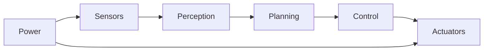

# Project overview

## Mission

<!-- One paragraph: what the robot does and who/what it is for. -->

## Requirements

| ID | Requirement | Priority | Verified by |
|----|-------------|----------|-------------|
| R1 | | Must | |
| R2 | | Should | |

## System architecture

## Constraints

- Budget:
- Deadline:
- Competition / safety rules:
